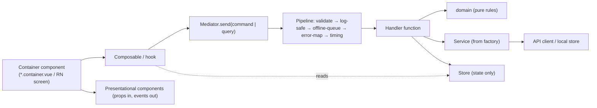

# Delivery platform and frontend architecture

Type: grilling
Status: resolved
Blocked by: 08, 12, 15, 18, 22, 23

## Question

Decided last among the product decisions, on best practices, once the engine, onboarding and core screens are known (Vang, MVP scope session). Which delivery platform and framework (PWA, PWA + Capacitor, React Native / Expo, Flutter, native Swift/Kotlin), weighed on: MVP launch in 8 weeks at ~18 h/week with AI agents, Vang's Vue 3 + TS strength, the post-MVP health-app connection increment (Health Connect, Apple Health; beta via Play closed testing and TestFlight), offline needs, the daily Check-in reminder channel, store policy and cost? Then the architecture: monorepo layout (Nx or not), routing, state management, offline-first strategy for Logs, Check-ins and Activities (local store, sync, conflict rules), i18n (EN + EL, ICU messages, units metric/imperial, time zones), component library / design-system base, the **theme layer** required by Core screens (framework-neutral token source with primitive and semantic tiers, light/dark themes, brand theme swappable without touching components; token format and build), and testing approach.

## Comments

- 2026-10-28 round 1 (Vang): Q1 changed: web is Vue 3 + Vite PWA, but **mobile apps are React Native** (not Capacitor). Q4 changed: Pinia + **custom reusable components with Tailwind, no component library**; add **mediator pattern**, **container pattern** (container → composable → mediator → handler functions → services), and **factory pattern** for API services. Q2, Q5–Q9 accepted.
- 2026-10-28 round 2 (Vang): Q10–Q15 accepted, plus **one package per UI component and one package per shared utility**. Agent risk noted once: React Native makes mobile a second UI codebase; mitigated by the framework-agnostic `app-core`.

## Answer

**Delivery**
- **MVP**: Vue 3 + TypeScript **PWA** on Cloudflare Pages.
- **Post-MVP increment 1**: **React Native (Expo, development builds, EAS)** apps for iOS and Android. They bring the health-app connection (`react-native-health`, `react-native-health-connect`), native reminders and store presence. The PWA stays live.
- First paid thresholds at increment 1: Apple Developer US$99/yr, Google Play US$25 once; EAS free-plan limits to be verified then.

**iOS PWA limits (MVP)**
- After the reveal, an "Add to Home Screen" guide for iOS users.
- Daily Check-in reminder by web push when installed, otherwise email via Brevo.
- Wake lock keeps the screen on for the rest timer.
- The app requests persistent storage.

**Architecture: the same layers in both apps**



- **Containers**: route level; call exactly one composable; pass plain props to presentational components; never touch stores or services.
- **Presentational components**: no state beyond UI state, no logic.
- **Composables / hooks**: screen state; every data change or read goes through `mediator.send()`.
- **Mediator**:
  - Typed **commands** (LogSet, LogActivity, SubmitCheckIn, AcceptAdaptation, LogMeal…) and **queries** (GetToday, GetWeek, GetSession…), each with a zod schema.
  - One handler per request type, registered centrally.
  - The shared pipeline runs on every request.
- **Handlers**: plain functions that use domain rules and services and write results to stores.
- **Stores**: Pinia on web, a store adapter on React Native. They hold state only and never call APIs.
- **Service factory**: `createServices(env)` returns typed `sessions`, `logs`, `activities`, `checkins`, `meals`, `adaptations`, `profile`, `sports` services.

| Environment | Implementation |
|---|---|
| Production / preview | Typed Hono client wrapped by an offline layer that writes locally first |
| Tests | In-memory mocks |
| Dev / prototype | Seeded fakes |

Storage is injected: Dexie (IndexedDB) on web, SQLite on React Native.

**Repo: pnpm + Nx; one package per component and per shared utility**

```
apps/web                  Vue 3 + Vite PWA (vite-plugin-pwa / Workbox), Vue Router, Pinia, vue-i18n (ICU)
apps/mobile               React Native (Expo), post-MVP
apps/api                  Hono on Deno Deploy EU; zod-openapi
packages/domain           pure TS rules: Load, progression, Deload, placement, Adaptations, nutrition targets, Screening outcomes
packages/app-core         mediator, commands/queries/handlers, pipeline steps, service factories, storage/transport interfaces (no Vue/React)
packages/contracts        zod schemas, OpenAPI, typed client
packages/tokens           DTCG token JSON (primitive + semantic) → CSS variables and a React Native theme object
packages/i18n             EN/EL ICU message files
packages/ui/<component>   one Vue package each: button, chip, chip-group, stepper, checkbox, text-field, card, sheet, tabs, bottom-nav, progress-bar, ring, load-bars, rest-timer, toast, suggestion-card, meal-card
packages/util/<name>      one package per shared utility: dates (UTC ↔ user time zone, local midnight), units (metric ↔ imperial), ids (UUIDv7), format (numbers and durations per locale), safe-log (allowlisted logging)
infra/                    OpenTofu + setup scripts
```

- **Nx module boundaries** (enforced in lint via tags):
  - `type:ui` and `type:util` depend on nothing app-specific.
  - `type:domain` depends only on `type:util`.
  - `type:app-core` depends on domain, contracts and util.
  - Apps depend on everything.
  - `scope:web` / `scope:mobile` / `scope:shared` keep Vue and React out of each other.

**UI kit**
- **Custom components only, Tailwind v4 bound to semantic tokens.** Components never use raw colours or sizes, so a brand theme replaces the placeholder without touching them.
- **Accessibility is owned in-house**: keyboard focus, ARIA roles (dialog focus trap, tabs), reduced motion, 44 px targets. Enforced by component tests and axe in CI.
- A dev-only `/dev/ui` page renders every component in both themes (no Storybook in the MVP).

**Offline-first**
- Logs, Check-ins, Activities and meal Logs are written locally first, with device-generated UUIDv7 IDs.
- An outbox syncs on app open, focus or `online` (no Background Sync on iOS).
- Server writes are append-only and idempotent by ID, so there are no merge conflicts.
- An offline Adaptation accept is queued; if the Session revision moved on, the server rejects it and the client refreshes.
- The week's plan and the exercise library are cached.

**API contract**: Hono with zod schemas published as OpenAPI; typed client in `packages/contracts`; runtime validation on both sides.

**i18n, units, time**
- ICU messages, EN + EL from day one.
- Metric canonical storage; imperial is a display conversion.
- UTC storage + user time zone; "today", caps and reminders follow the user's local midnight.

**Reminders**
- A scheduled job sends daily Check-in reminders at each user's local time: web push, or email.
- Deno Deploy cron if the current product supports it (UNVERIFIED); otherwise a GitHub Actions schedule calls an internal endpoint.

**Testing**
- **Vitest**: domain golden tests, `app-core` handler tests through a mock-service mediator, component tests.
- **Playwright** at phone size on every PR preview: onboarding, a Session with offline logging then sync, "I played" → accept suggestion, meal logging.
- **axe** accessibility checks.
- The engine's 50-prompt eval set runs in CI on prompt changes.

**Propagated**
- Post-MVP 01 (health-app connection) is now React Native + Expo.
- Engineering process gets Nx affected CI, module-boundary lint and the test suites above.
- Fog cleared: "API contract style" (decided above) and "Notifications and reminders" (decided above).
