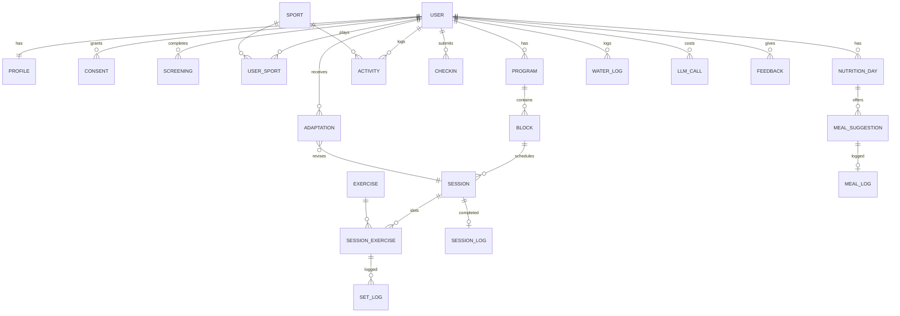

# Data model, database, privacy and backups

Type: grilling
Status: resolved
Blocked by: 05, 06, 12

## Question

Which database platform on a free tier, and what data model: users, profiles, Goals, screening answers, Sport Profiles (draft / approved, requested-by, sources), exercises with Stamina tags, Programs, Blocks, Sessions, set Logs (weight, reps, RPE), Activities with Load, Check-ins, meals and meal Logs, Adaptations (triggering rule, reason text, accepted/declined), consents? How is health data protected (field-level encryption, row-level security, EU residency), versioned (Program history for reproducibility), retained and deleted (GDPR erasure, export), and backed up on a free tier? What is the scaling path to multi-region without a rewrite? Includes auth choice where the platform bundles it.

## Comments

- 2026-10-28 round 1 (Vang accepted all recommendations Q1–Q8).

## Answer

**Platform**: **Neon Postgres, AWS Frankfurt**, with **Neon Auth** (managed Better Auth). Why not the others:
- **Supabase free**: pauses after 1 idle week and has no backups.
- **Appwrite free**: the same problems, and it is not Postgres.
- **Firebase**: no file storage on the free plan, and the database location is fixed for ever.

Neon free tier:
- 1 GB database per project, 100 CU-h per month, 60k auth MAU, 5 GB object storage, 6 h point-in-time restore, no inactivity pause (scales to zero after 5 min).
- **First paid threshold**: going over any of those limits, or wanting a longer restore window, moves the project to Launch, which is pay-as-you-go at $0.106/CU-h and $0.35/GB-month with no monthly minimum.
- Rough size [INFERENCE]: about 2.5k set Logs per active user per year, so 100 users stay well under 100 MB.

**Backups**: Neon's 6 h restore window, plus a **nightly encrypted `pg_dump`** made by a scheduled GitHub Action:
- stored in a **Cloudflare R2 bucket in the EU jurisdiction** (free up to 10 GB; first paid threshold > 10 GB);
- **kept 30 days**;
- **restored monthly** into a scratch database as a test (GDPR Art. 32).

**Residency and scaling**: all user data stays in the EU (Neon Frankfurt, EU-jurisdiction R2). Every user has a `home_region` from day one.
- **Multi-region = one full stack per region** (EU, later US, …). Each user is routed to their home region at sign-up.
- Read replicas are added within a region when needed.
- No cross-region copies of health data.

**Protection**
- Platform encryption at rest and TLS in transit.
- **Row-level security on every table**, keyed to the user ID.
- **App-level envelope encryption** for screening answers and any health free text. Check-ins, Load and set Logs stay queryable.
- No health data in logs, error reports or analytics.
- LLM calls carry a pseudonymous ID only.
- **Minimisation**: birth year (not full date of birth), no menstrual-cycle data, no medical free text in the MVP.

**Reproducibility**: plans and Logs are never edited in place.
- An accepted Adaptation writes a new Session **revision** with `supersedes_id`.
- Every generated Session stores `rules_version`, `model`, `prompt_version` and an inputs hash.
- Logs, Check-ins, Activities, Adaptations and consents are append-only.

**Retention and rights**
- **Account deletion**: hard-delete all rows within **30 days** (inside GDPR's one month and Washington MHMDA's 45 days); backups age out on the same 30 days, stated in the privacy notice.
- **Export**: one tap, JSON of all data plus CSV of Logs.
- **Withdrawing health-data consent** stops processing and offers export, then deletion.
- **Inactive accounts** are deleted after **24 months**, with an email warning 30 days before.
- **Consents** are append-only rows: purpose, text version, granted at, withdrawn at.

**Data model**

| Entity | Key fields |
|---|---|
| PROFILE | birth year (18+ gate), height, weight, level, Goal, Sessions per week, Session minutes, available days, equipment, locations, food preferences and allergies, locale, units, time zone, `home_region` |
| SCREENING | instrument, version, answers (encrypted), outcome (cleared / limited / referred), taken at |
| SPORT | status (draft / approved / rejected), requested by, Sport Profile JSON (energy mix, key movements, high-load areas, typical Activity, recovery window, season), sources, approved by, version |
| EXERCISE | source, source ID, licence, image, attribution, Stamina tags (equipment, location, movement pattern, high-load areas, slot, RIR-suitable, easier and harder variant) |
| SESSION | date, status, revision, `supersedes_id`, `rules_version`, `model`, `prompt_version`, inputs hash |
| SESSION_EXERCISE / SET_LOG | slot, exercise, sets, reps range, RIR, load / weight, reps, RPE, logged at |
| ACTIVITY | date, minutes, RPE, Load, planned or unplanned, source (manual / health app) |
| CHECKIN | date, sleep, soreness, energy (1–5) |
| ADAPTATION | rule ID, trigger references, change, reason text, status (pending / accepted / declined), decided at |
| LLM_CALL | pseudonymous user, purpose, model, tokens, cost (feeds the per-user cost cap) |
| FEEDBACK | includes the "would you pay €7.99/month?" answer |

**Sign-in**: email one-time code + Google in the MVP via Neon Auth; no passwords. Sign in with Apple ships with the iOS app (App Store guideline 4.8). The provider that sends the email codes is chosen in Cloud setup.

**Propagated**:
- Cloud setup: backup job, R2 bucket, email-code provider; hosting compute must keep health data in or transferred lawfully from the EU.
- Generation engine: generation metadata and the LLM_CALL cost ledger.
- Fog: "Multi-region mechanics" is decided and removed; "API and auth details" is narrowed to API style.
