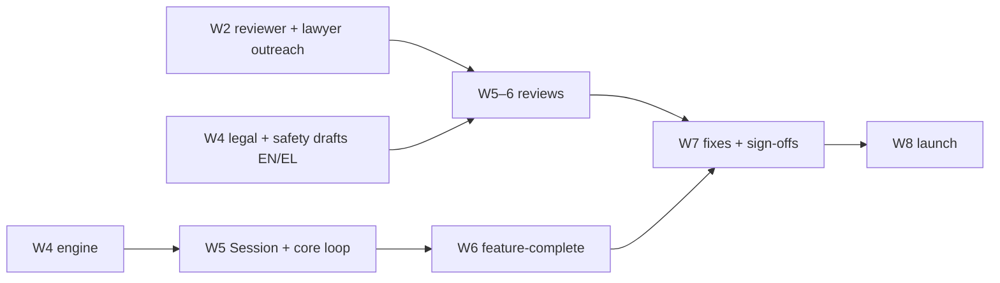

# 8-week roadmap and top risks

Type: grilling
Status: resolved
Blocked by: 13, 14, 18, 19, 20, 21, 22, 23, 25, 26, 30, 31, 32

## Question

Given all decisions so far and ~18 h/week with AI agents (MVP scope estimated ≈139 h against ≈144 h): what ships each week (weekly milestones with clear deliverables, ~30 real users by week 8, 100 by week 12), what is the critical path, what are the top 5 risks with mitigations, and which decisions are marked [Vang] vs [External] with their needed-by week? Also: the order and rough size of the post-MVP increments (`.scratch/post-mvp-increments/issues/`, proposed increment numbers to confirm or change).

## Comments

- 2026-10-28 (from Greek localisation): add ≈ 12 h of localisation work (safety/legal EL copy by week 4; the rest by week 6). The MVP estimate is now ≈ 151 h vs ≈ 144 h available; this ticket must close the ≈ 7 h gap. Also schedule the [Vang] legal drafting (week 4), lawyer review (weeks 5–6), legal admin (week 6), reviewer outreach (week 2) and reviews (weeks 5–6).
- 2026-10-28 round 1 (Vang accepted all recommendations Q1–Q4).

## Answer

**Budget**

| Item | Hours |
|---|---|
| MVP scope after cuts | ≈ 139 |
| + Greek localisation | + 12 |
| + name check | + 1 |
| **Total (landing page moved post-MVP)** | **≈ 152** |
| Available: **19 h/week × 8** | **≈ 152** |

There is no slack, so risk 2's cut list is pre-agreed. All hour figures are [INFERENCE] estimates.

**Weekly plan** (build = agents write, Vang reviews; [V] = Vang non-coding; [E] = external)

| Week | Build | [V] / [E] | Milestone |
|---|---|---|---|
| 1 | Repo, Nx, CI; OpenTofu: Neon, Deno Deploy, Cloudflare Pages + R2, Sentry, UptimeRobot; Neon Auth + Brevo; tokens, i18n and UI-kit scaffolding | [V] `gh auth login` + repo bootstrap; send PAR-Q+/CSEP emails; list ~40 ICP contacts; open service accounts | Empty app deployed with sign-in; PR previews live |
| 2 | Drizzle schema + RLS; `app-core` mediator, pipeline, factories, offline outbox; domain: Load, units, dates | [V] reviewer outreach (2 candidates each, fixed fee); request 2 lawyer quotes | Data + application layer done |
| 3 | Onboarding: country + age gates, consent, Screening, outcomes; exercise library import + tagging (part 1); Sport Profile script + batch review of 11 | [V] name shortlist + EUIPO/TMview/domain checks; [E] licence replies due (≈ day 14 after sending) | Onboarding works end to end |
| 4 | Training engine: rules + Anthropic picks + validators + fallbacks; library tagging (part 2) | [V] legal drafts EN/EL; safety copy EL; **name chosen**; lawyer booked; Anthropic account with $10 hard cap | First Program generated |
| 5 | Session screen (focus mode, rest timer, overview); "I played" + Load + Check-in + Adaptation suggestions | [E] physio, dietitian (rules) and lawyer reviews start | Core loop works |
| 6 | Nutrition: targets, AI meals with ingredient IDs, ~60 templates, meal Log, water; Today timeline; Progress; reminders (web push / email); bulk translation | [E] dietitian template pass; [V] admin: HDPA portal, DPAs accepted, privacy@ | Feature-complete |
| 7 | Reviewer + lawyer fixes; GDPR export/deletion/withdrawal; Playwright + axe; 50-prompt EN/EL eval set; feedback + "would pay" prompt; iOS install guide; daily digest | [E] **physio + dietitian sign-offs**; lawyer findings closed | Release candidate |
| 8 | Hardening; go/no-go checklist (sign-offs, DPIA final, backups + restore tested, kill switch tested) | [V] invite **wave 1: ~30 users in batches of 10**; support | **Live with ~30 real users** |

After the MVP:
- weeks 9–10: indoor-season partners;
- week 9 and week 11: 5 user calls each;
- weeks 11–12: 3 invites per user, reaching ~100;
- weeks 12–14: charging gate evaluated.

**Critical path**

**Top 5 risks**

| # | Risk | Mitigation |
|---|---|---|
| 1 | Reviewers or lawyer late → launch gate slips | Outreach in week 2 with 2 candidates each; fixed fees and deadlines in writing; if a sign-off is late, launch only to 10 informed test users with every safety rule active |
| 2 | Hours overrun (no slack; estimates ±30 %) | Weekly hours tracked on the board; pre-agreed cuts in order: Progress → Sessions only; "another idea" → templates; 11 → 7 launch Sport Profiles; "Other (beta)" → Activity-only; meal ideas → templates for the first 2 weeks |
| 3 | LLM output quality/safety, especially in Greek | Strict validators, ingredient-ID allergen checks, EN/EL never-advise filter, template fallback, 50-prompt eval gate, kill switch, dietitian samples 20 meals |
| 4 | Low retention (core loop doesn't catch on) | Adaptation-acceptance metric from day 1; user calls in weeks 9 and 11; the charging gate prevents monetising a leaky product |
| 5 | Compliance drift (medical-device creep, GDPR gaps) | Copy rules + never-advise list in the PR checklist and CODEOWNERS; DPIA + lawyer review; EU/EEA-only beta; physio sign-off |

**Open [Vang] and [External] items with needed-by weeks**

| Item | Owner | Needed by |
|---|---|---|
| Install `gh`, create the private repo, decide GitHub Pro ($4/mo) if Free can't protect `main` | [Vang] | W1 |
| Send PAR-Q+ / CSEP licence emails | [Vang] | W1 (replies ≈ W3) |
| List ~40 ICP contacts | [Vang] | W1–2 |
| Reviewer outreach + fee per quote | [Vang] → [External] | W2 → sign-offs W7 |
| Lawyer: 2 quotes, book one | [Vang] → [External] | W2 → booked W4 → review W5–6 |
| Product name (EUIPO/TMview + domain) | [Vang] | W4 |
| Legal + safety drafts EN/EL | [Vang] | W4 |
| Anthropic account with $10 hard cap | [Vang] | W4 |
| HDPA portal, processor DPAs, privacy@ | [Vang] | W6 |
| HDPA prior consultation, only if the DPIA requires it | [External] | W6 |
| Business registration (έναρξη) | [Vang] | The week payments ship (≈ W12–14, after the gate) |
| Apple ($99/yr) + Google Play ($25) accounts | [Vang] | Increment 2 |

**Post-MVP order** (backlog `Proposed increment` updated to match)

| Increment | Contents |
|---|---|
| 1 (weeks 9–14, web) | Payments and subscriptions (after the gate) · weekly re-plan · Progress trends + Adaptation history · pre-Session reminders · sport review-queue screen · landing page · brand theme |
| 2 | React Native apps + Health Connect / Apple Health (store beta); consider a medical-device regulatory consultant before store listing |
| 3 | Food logging · video demos · custom Sessions · event prep · sport-specific Session programming · weather feed · adaptive energy targets · personalised guidance cards |
| 4 | Social · coach and team accounts · wearables · AI chat · progress extras · camera form check · more locales |
