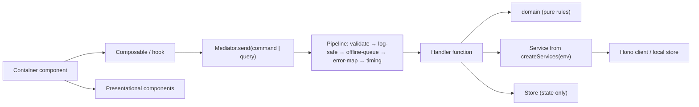

# Stamina: MVP plan

*Working name: "Stamina". The real name is chosen by build week 4. Plan date: 28 Oct 2026. Every decision links to the ticket that holds its detail and evidence. Estimates marked [INFERENCE] are the planner's judgement, not sourced facts.*

**In one paragraph.** Stamina is an AI coach that plans **training, food and recovery around the sport you actually play**, and adapts when you've played. It's for 18+ intermediate amateur athletes, starting in Athens. It works for any sport: users pick from 11 launch sports or request another. Rules decide every number and every safety call, and the AI only picks exercises from an allowed list and writes meal ideas. The MVP is a **Vue 3 PWA** running on **free tiers in the EU**, built in **8 weeks at about 19 h/week with AI agents**. It launches as a **free, invite-only beta**: about 30 users in week 8 and 100 by week 12. Charging starts only once week-4 retention reaches 40% and at least 30 users say they'd pay. **React Native apps** with Apple Health / Health Connect come in increment 2.

| Key number | Value |
|---|---|
| Build budget | ≈ 152 h (19 h/week × 8), no slack, cut list agreed in advance |
| Running cost at 100 users | ≈ $2/month (AI). Everything else on free tiers |
| Price after the beta | €7.99/month or €59.99/year, 14-day trial with no card |
| Launch gate | Physio and dietitian sign-offs, lawyer review, DPIA |

---

## 1. Entrepreneur / Product Owner

**Problem.** Amateur athletes fit gym work and eating around their sport with no plan that reacts to what they actually played. Generic apps don't know a game or a windy afternoon happened. Today they piece it together from Fitbod, MyFitnessPal, YouTube and guesswork. Sources: [Who is the first user, and how is Stamina positioned?](../.scratch/mvp-plan/issues/02-first-user-and-positioning.md), [Competitor teardown](../.scratch/mvp-plan/issues/03-competitor-teardown.md).

**Who it's for (first 100 users).** Adults 18+ (mostly 25–45), active for at least a year, in Athens, EU/EEA residents only. They play a sport regularly, whether on a fixture list or when the weather allows: padel, tennis, beach volleyball, kitesurfing, windsurfing, basketball, 5-a-side football, running, CrossFit, HYROX, calisthenics. They have gym access or basic kit at home, and can do 2–4 Sessions of 30–60 minutes a week. Team players with a coach are included: their practices count as Activities.

**Who it's not for.** Turned away at screening: under-18s, pregnancy, injury rehab, known heart, metabolic or kidney conditions. Not targeted: bodybuilders, strict calorie counters, elite athletes, gym-goers who don't play a sport, endurance specialists.

**Positioning.** *"The AI coach that plans your training, food and recovery around the sport you play, and adapts when you've played."* The lead feature is **adapting to the sport you play**: no competitor has a daily readiness Check-in or knows you played.

| | Fitbod | MyFitnessPal | Future | **Stamina** |
|---|---|---|---|---|
| Covers | Gym training | Food logging | Human-coached training | Training + Nutrition + Mobility & Recovery + Daily Routine, as one Program |
| Knows you played your sport | No | No | Weekly, via a human coach | **Yes**: an Activity (or later a health-app import) triggers a suggested change |
| Daily readiness Check-in | No | No | No | **Yes** |
| Price (Greece) | €17.99/mo | €21.99/mo Premium | US-only, $199/mo | **€7.99/mo** |

**MVP scope.** Source: [MVP scope per Pillar, including Nutrition depth](../.scratch/mvp-plan/issues/12-mvp-scope.md).

| In the MVP | Out (post-MVP backlog) |
|---|---|
| 11 launch sports + user requests you approve; AI-suggested Sessions; set logging with a rest timer; one-tap "I played"; daily Check-in; Adaptation suggestions after an Activity or a poor Check-in; Nutrition targets + AI meal ideas + one-tap meal Log + water; warm-ups, cool-downs and recovery Sessions; Today timeline; Progress (Sessions done, weekly Load); one daily reminder; EN + EL; GDPR export and deletion | Health-app connection, payments, weekly re-plan, food logging, video demos, custom Sessions, event prep, social, coach and team accounts, wearables, AI chat (see §15). **Never:** injury, pain or rehab routines |

**How it makes money.** Source: [Monetization and pricing](../.scratch/mvp-plan/issues/13-monetization.md), [Selling subscriptions from Greece](../.scratch/mvp-plan/issues/30-selling-subscriptions-from-greece.md).
- **Plans:** a 14-day trial with no card, then one subscription at **€7.99/month or €59.99/year**, VAT included, the same price everywhere. No free tier, no ads, no selling data.
- **When trial or subscription ends:** history becomes read-only, and export and deletion stay available.
- **Beta users:** free until payments ship. Then a founding offer: **€39.99 for the first year**, upfront.
- **Web payments:** **Paddle**, which collects and pays the VAT. It must confirm it accepts "fully automated software", because it bans coaching businesses. Fallback: Stripe plus an accountant.
- **Net per subscriber:** about €5.59 on Paddle. **About 29 subscribers cover the ~€160/month social insurance** (e-ΕΦΚΑ) that starts when you register the business.
- **When charging starts:** only when **week-4 retention ≥ 40% and ≥ 30 "would pay" answers**, evaluated around weeks 12–14.

**Success metrics.** All computed from our own database; no analytics tool, no cookie banner. Targets are [INFERENCE] hypotheses. Source: [Success metrics and go-to-market](../.scratch/mvp-plan/issues/14-metrics-and-gtm.md).

| Metric | Target |
|---|---|
| Activation (onboarded + first Session within 7 days) | ≥ 60% |
| **Week-4 retention** | **≥ 40%** (charging gate) |
| Adherence (Sessions done ÷ planned) | ≥ 60% |
| Check-in rate | ≥ 50% of days |
| Adaptation acceptance | ≥ 50% |
| NPS | ≥ 30 |
| "Would pay €7.99/month" (asked in each user's 4th week) | **≥ 30 yes** (charging gate) |

**Go-to-market for the first 100.** Planned for winter, when indoor sports are in season:

| Build week | Action | Users |
|---|---|---|
| 1–2 | List ~40 people from your network who fit the profile | – |
| **8** | Wave 1: invite them in batches of 10 | **~30** |
| 9–10 | Partners: 2 padel clubs, 1 CrossFit/HYROX box, 1 basketball or 5-a-side league, 1 running club. The coach or owner gets free access, members get a beta code | ~65 |
| 11–12 | Each active user gets 3 invites | **~100** |
| Spring | Kite and windsurf schools, beach volleyball groups | – |

There's no content marketing during the build. There are 5 user calls in week 9 and 5 more in week 11.

## 2. UX/UI Designer

Sources: [Onboarding flow](../.scratch/mvp-plan/issues/22-onboarding-prototype.md) (prototype on branch `prototype/onboarding`), [Core screens](../.scratch/mvp-plan/issues/23-core-screens-prototype.md) (prototype on branch `prototype/core-screens`).

**Onboarding: "Fast start", 8–9 screens to the first Program.** Both prototypes were tested in a headless browser; the onboarding one through 18 scripted paths across 3 variants.
1. What you want (training, food or both), **birth year** and **country of residence**. Under-18s and non-EU/EEA users stop here, before any consent or health question.
2. Sport (11 + "Other…"), when you play (or "it varies"), usual duration, how hard.
3. Goal.
4. Training week: Sessions per week, length, available days.
5. Disclaimer, then **explicit consent to process health data** (a separate, unticked box).
6. Starting level, plus **all 10 health questions on one page** ("If unsure, answer yes"), plus a body-area picker if needed.
7. Save your plan: email code or Google.
8. Reveal: Block 1, the week arranged around sport days, today's food targets, "Suggested by AI" labels.

Afterwards, "Finish setup" cards ask for equipment (until then the app assumes bodyweight + dumbbells) and unlock Meals (body stats + food preferences). Reminder permission is asked after the first Check-in.

**Core screens:**

| Screen | Design |
|---|---|
| **Today** | The day in time order: meals, Session, Activities, water, wind-down. **Suggestions sit inline at the top**, each with the change, the reason, Accept and Keep my plan. The Check-in asks one question per screen. **＋ I played** is always visible |
| **Session** | **One exercise per screen**: big weight and rep steppers, RPE 6–10 chips, "Done · set N". **Full-screen rest timer**. A table overview of the whole Session. A Stop button for stop flags |
| **Meals** | **Next-meal card** first: the idea, ate it / something else / skipped, "another idea". Then targets and water, then the rest of the day |
| **Progress** | Sessions done vs planned. Weekly Load bars against the 4-week average. A one-sentence verdict on the week |
| **Navigation** | Labelled bottom tabs. No bell or hidden inbox |

**Design system.** It must be themeable:
- **Two levels of tokens:** raw values (palette, fonts, sizes) and named roles (`bg`, `surface`, `text`, `accent`, `load`, `suggest`, …).
- **Components only use the named roles.** Light and dark modes follow the phone's setting.
- **Placeholder theme:** system font, type scale 12/14/16/20/24/32/48, spacing 4/8/12/16/24/32, radius 8/16/pill, **44 px minimum tap target**, green accent, blue for Load, amber for suggestions.
- **The brand theme** replaces only the raw values, after week 12.

## 3. Strength & Conditioning Coach

Source: [Training generation model](../.scratch/mvp-plan/issues/15-training-generation-model.md). All thresholds are starting values to tune from beta data.

- **Sport Profile, one per sport:** energy mix, key movements, body areas under the most load, typical Activity, recovery window, season, and intensity values for each effort level (used for calorie estimates). The AI drafts it with cited sources; **you approve it** before anyone else sees it. No program is hard-coded for any sport.
- **Blocks:** 4 weeks each, rolling on: 3 build weeks, then 1 Deload. Each Block has one emphasis (Strength / Power & speed / Strength-endurance), chosen from the Goal, the Sport Profile and the season.
- **Session:** 5 parts scaled to 30, 45 or 60 minutes: warm-up → main strength (2–3 compound lifts) → sport-specific work → accessories and core → cool-down.
- **Who decides what:** the AI picks exercises **only from the library**. **Rules set every number** (sets, reps, reps in reserve (RIR), load) and every scheduling decision.

| Emphasis | Reps | Reps in reserve |
|---|---|---|
| Strength | 4–6 | 2 |
| Power & speed | 3–5, moved fast | ≥ 3, stop when speed drops |
| Strength-endurance | 10–15 | 2 |

- **Reps in reserve through the Block:** week 1 RIR 3 → week 2 RIR 2 → week 3 RIR 1 → Deload week at RIR 4 with half the sets.
- **Adding weight:** when every set hits the top of the rep range at or below target effort, add +2.5 kg (upper body) or +5 kg (lower body). If 2 sets come in at target RPE + 2 or more, take 5% off. No max-out testing: week 1 weights are guided by RPE.
- **Load:** RPE × minutes for every Session and Activity, compared with **the user's own 4-week average**. No injury-risk ratios.
- **Scheduling:**
  - no heavy Session for a body area inside the recovery window before a hard Activity;
  - no Session on a hard Activity day;
  - at least 1 day off a week;
  - sets scale so the week's Load stays within +10% of the average.
- **Suggestions (accept or decline, never automatic):**
  - an unplanned Activity → move the Session ±1 day, else swap to recovery, else drop a set;
  - a poor Check-in → lighter version;
  - a good Check-in **never** makes things harder;
  - early Deload when Load is above 1.3 × average for 2 weeks, or after 3 poor Check-ins in 5 days, or after 2 Sessions in a row at target + 2.
- **Missed Sessions:** never stacked. Missing 2 repeats the week; missing 2+ weeks restarts the Block.
- **Exercise library:** about 150 curated exercises. Data comes from free-exercise-db (public domain); images come from wger (CC-BY-SA, unmodified, credited). Each has Stamina tags: equipment, location (gym / home / court / beach), movement pattern, body areas under load, slot, RIR-suitable, easier and harder variants.
- **Example, padel Tue + Fri, hard:** Monday becomes an upper-body Session, nothing heavy goes on legs before a match, and a pickup match on Wednesday suggests swapping Thursday's leg Session for recovery.

## 4. Physician (Longevity & Wellbeing)

Sources: [Safety rules](../.scratch/mvp-plan/issues/16-safety-rules.md), [Medical-device boundary](../.scratch/mvp-plan/issues/04-medical-device-boundary.md), [Screening sources](../.scratch/mvp-plan/issues/10-screening-sources.md).

**Principle.** Stamina stays a wellness product only if its safety features **block, limit or refer**, never name a condition, never compute a risk score, and never "clear" anyone. Whether it's a medical device depends on what it claims, not on its algorithm.

**Screening:** 10 yes/no questions, repeated every 12 months or after "My health has changed". The wording is licensed PAR-Q+/GAQ text if permission arrives, otherwise our own questions built from ACSM's public screening logic.

| Answer "yes" to | Outcome |
|---|---|
| Heart condition / stroke / high blood pressure · chest pain · fainting or dizziness · diabetes or kidney disease · breathlessness or asthma care · concussion · pregnancy · supervised exercise only | **Referred**: no Program; "please talk to a doctor" (for pregnancy, "your doctor or midwife") |
| Eating disorder | Nutrition off; the body-composition Goal is unavailable |
| Bone, joint or muscle problem | **Area excluded**: exercises loading it are left out. Never a rehab plan |

After a referral, the statement "**A doctor has said I can train**" unlocks a **Limited** first Block: RPE ≤ 7, no explosive or jumping work, no RIR 1 weeks. This option isn't offered for pregnancy.

**Stop flags.** Reported in the Check-in ("Anything unusual today?") or with the Session's Stop button.

| Flag | What happens |
|---|---|
| Chest pain · fainting or dizziness · unusual breathlessness · racing or irregular heartbeat | Session stopped. "**If severe or not settling, call 112**" (the local emergency number). Paused until the user confirms a doctor has seen them |
| Fever or feeling ill | Rest for the day, no training while the fever lasts |
| New pain or swelling | That area is excluded, with "get it checked" |
| Head knock | Paused until a doctor has cleared them |

**Recovery, sleep and hydration guidance:**
- Deloads and recovery Sessions after hard Activities.
- A 22:30 wind-down on the Today timeline and a 7–8 h sleep card.
- Hydration targets with an electrolyte note and an over-drinking cap (§5).
- The IOC warning-signs card for low energy availability (RED-S).

**Never advise:**
- diagnosis, or what a symptom might mean;
- rehab, return-to-play, or "fix your knee";
- medication or supplements, or their doses;
- exercise or diets for a named condition;
- injury-risk scores, or "prevents injury";
- hormone, testosterone or detox content;
- training through pain;
- eating below resting energy, fasting protocols, or weight-loss promises;
- anything for under-18s or pregnant users.

**Disclaimers.**
1. At onboarding, accepted before screening.
2. At the first Session of each Block.
3. In the Meals footer.
4. In Settings → Safety.
5. On the store page and website.

**Launch gate.** No real users until a licensed physio or sports physician has signed off the screening, outcomes, stop flags, never-advise list and disclaimers.

## 5. Nutritionist

Sources: [Nutrition and hydration logic](../.scratch/mvp-plan/issues/17-nutrition-hydration-logic.md), backed by position stands (ISSN, ACSM/AND/DC, IOC REDs 2023), EFSA, and Regulation 1169/2011.

| Element | Rule |
|---|---|
| Resting energy | Mifflin-St Jeor. Men: 10·kg + 6.25·cm − 5·age + 5. Women: the same − 161. "Prefer not to say": the midpoint (−78) [INFERENCE] |
| Daily energy | Resting energy × everyday-activity factor (1.4 mostly sitting / 1.5 on my feet / 1.7 physical job) [INFERENCE: avoids counting exercise twice] + **(MET − 1) × kg × hours** for each Session and Activity (2024 Compendium of Physical Activities). Every day type gets its own target |
| Goal adjustment | Fat loss −400 kcal (never on hard Activity days); muscle gain +250 kcal [INFERENCE]. If loss runs above 1% of bodyweight a week for 2 weeks, the deficit halves |
| Floor | Never below resting energy [INFERENCE]. If the weight-loss check triggers twice: "talk to a dietitian or doctor" |
| Protein | 1.6 g/kg (2.0 when losing fat), about 0.3 g/kg per meal |
| Carbs | 3 / 4 / 5 / 6–7 g/kg for rest / Session / Activity / hard Activity days. About 1 g/kg 1–4 h before an Activity; 30–60 g per hour during Activities over 90 minutes |
| Fat | At least 20% of energy, up to 35% |
| Water | Drinks 2.0 L (men) / 1.6 L (women) / 1.8 L (prefer not to say), plus 0.5 L per hour of training, plus 0.25 L per hour when hot. 5–10 ml/kg in the 2–4 h before an Activity. Electrolyte note for Activities over 2 h or hot. **Never more than 1 L per hour of exercise, "drink to thirst"** |
| Preferences and allergies | Eating pattern (everything / pescatarian / vegetarian / vegan), **the 14 EU allergens**, dislikes, meals per day (3–5), cooking effort |
| Meal ideas | Rules set each meal's targets. The AI returns **ingredient IDs** from a list of about 300 ingredients (EN/EL names, allergen tags, household measures). **The allergen check runs on those IDs**, so it never depends on the AI. After 2 failures, a fixed template is used (about 60 templates) |
| Recovery nutrition | A carb + protein meal after hard Activities; extra fluid and carbs on Activity days |
| Never | Supplement advice (only a generic electrolyte-drink note), claims that a food prevents or treats anything, named conditions, detox promises |

**Launch gate.** A licensed dietitian signs off the rules. A second pass reviews the templates, the allergen table and 20 sampled AI meals.

## 6. Senior Database Engineer

Source: [Data model, database, privacy and backups](../.scratch/mvp-plan/issues/20-data-model-and-db.md).

- **Database:** **Neon Postgres, Frankfurt (EU)**, with **Neon Auth**. Why not the others:
  - Supabase and Appwrite free projects pause after a week idle and have no backups.
  - Firebase has no file storage on the free plan, and its location is fixed for ever.
- **Main tables:** user, profile (birth year, `home_region`, locale, units, time zone, Goal, schedule, equipment, food fields), consent, screening (encrypted answers + outcome), sport (Sport Profile JSON, status, approver), exercise (tags, licence), program, block, session (revision, `supersedes_id`, `rules_version`, `model`, `prompt_version`, inputs hash), session exercise, set log, session log, activity (Load, planned or not, hot), check-in, nutrition day, meal suggestion, meal log, water log, adaptation (rule, reason, status), llm_call (cost log), feedback.
- **Privacy:**
  - **Each user can only read their own rows** (row-level security on every table).
  - Screening answers have extra encryption on top of TLS and encryption at rest.
  - No health data in logs, analytics or AI prompts.
  - Only birth year is stored, not full date of birth.
- **History you can trace:** nothing is edited in place. Logs, Check-ins, Activities, Adaptations and consents only get new rows; an accepted Adaptation creates a new Session revision.
- **Backups:**
  - Neon's 6-hour restore window.
  - A **nightly encrypted dump to an EU Cloudflare R2 bucket**, kept 30 days.
  - **A restore test every month.**
- **Retention:**
  - Deleting an account removes everything within 30 days, including from backups.
  - Inactive accounts are deleted after 24 months, with a warning first.
  - One-tap export as JSON, plus CSV of Logs.
- **Scaling path:** each user has a `home_region`. Growth means **one complete copy of the stack per region**, with users routed to their home region and read replicas added within a region. Health data is never copied between regions.
- **Migrations:** Drizzle, forward-only, with the row-level security policies included.

## 7. Principal Frontend Engineer

Source: [Delivery platform and frontend architecture](../.scratch/mvp-plan/issues/19-frontend-architecture.md).

**Platform.** A **Vue 3 + Vite + TypeScript PWA** now, with Pinia, Vue Router, vite-plugin-pwa and vue-i18n. Then **React Native (Expo)** apps in increment 2, for Apple Health / Health Connect, native reminders and the app stores.

**Architecture, the same layers in both apps:**

- **Containers** call exactly one composable. **Presentational components** take props and emit events. **Every data change or read is a command or query** sent through the mediator. **Stores only hold state.**
- **Services come from factories:** API-backed in production, in-memory mocks in tests, seeded fakes in development.
- **`packages/app-core`** (mediator, handlers, pipeline, factories) is plain TypeScript with no Vue or React, so React Native rebuilds only the views and hooks.
- **Monorepo:** pnpm + Nx, with **one package per UI component** and **one per shared utility** (dates, units, IDs, formatting, safe logging). Nx tags enforce the module boundaries.
- **UI:** custom Tailwind v4 components on the semantic tokens, with no component library. Accessibility is ours to own (focus, ARIA roles, reduced motion, 44 px tap targets), checked by component tests and axe.

**Offline.** Logs, Check-ins and Activities are saved on the phone first (IndexedDB, IDs created on the device) and synced on open, focus or reconnect. The server ignores records it already has, so there are no conflicts. A plan accepted offline is checked against the latest revision when it syncs.

**Language, units and time.** ICU messages in EN and EL, with CI failing on any missing Greek key. Metric storage, imperial for display. UTC storage plus each user's time zone, so "today" follows local midnight.

**iOS web-app limits.** After the reveal, a guide to adding the app to the Home Screen. Reminders go by web push when installed, otherwise by email. The rest timer keeps the screen on, and the app asks for persistent storage.

## 8. Principal Backend Engineer

Sources: [Generation engine](../.scratch/mvp-plan/issues/18-generation-engine.md), [Cloud setup](../.scratch/mvp-plan/issues/21-cloud-and-environments.md), [Data model](../.scratch/mvp-plan/issues/20-data-model-and-db.md).

**API.** **Hono** (TypeScript, web standards) on **Deno Deploy, EU region**, close to Neon Frankfurt. zod schemas are published as OpenAPI, and a typed client lives in `packages/contracts`. Rate limits per user.

**Auth.** Neon Auth: an email code (sent through **Brevo**) or Google, no passwords. Sign in with Apple comes with the iOS app.

**Generation engine: a hybrid, rules first.**

| The AI does | Rules do |
|---|---|
| Picks exercises from a list the rules have already filtered (by equipment, location, excluded areas, Limited mode). Writes meal ideas as ingredient IDs in the user's language. Drafts Sport Profiles in a script on your machine | Every number, every schedule, every Adaptation, all nutrition targets, every safety outcome. Explanations come from fixed EN/EL templates |

- **Provider:** **Anthropic Claude Haiku 5.5**. It has a hard monthly spend cap, output guaranteed to match the expected structure, and no training on our data. Fallback: OpenAI gpt-5-nano. If the DPIA requires EU-only processing: Mistral's EU endpoint.
- **No health data in prompts:** no user ID, age, sex, weight, Check-ins or screening answers. Allergens are sent mixed in with dislikes, unlabelled.
- **Output checks:** strict structure checks; exercise IDs must come from the allowed list; allergen check by ID; a never-advise term filter (EN + EL); protein within ±30% of target. If a check fails, a retry, then a rules-only or template fallback.
- **Cost:** about $2/month for 100 users [INFERENCE]. **Hard cap $10/month**; per user, 15 calls a day and 3 "another idea" a day. **Kill switch at 80%** of the cap, falling back to rules and templates.
- **Testing:** three seams (agreed in the build spec): **the API over HTTP** (real Hono app + Postgres, AI provider faked; the rules are tested through it with fixture users), **the `app-core` mediator** (offline queue, sync, stores), and **a few Playwright journeys** with axe. AI quality is gated separately by a **50-prompt evaluation set (25 EN + 25 EL) at ≥ 98%** before any prompt change ships. Stored AI answers are never regenerated.
- **Transparency:** a "Suggested by AI" label (EU AI Act Art. 50). Anthropic is named as a processor in the privacy notice.

**Integrations later.** Apple Health and Health Connect come with the React Native apps (increment 2), importing Activities. Payments (Paddle) come in increment 1.

## 9. DevOps

Source: [Cloud setup, environments, monitoring and cost guardrails](../.scratch/mvp-plan/issues/21-cloud-and-environments.md).

- **Environments:** local (on a Neon `dev` branch) · **one preview per pull request** (Cloudflare Pages + Deno Deploy + its own Neon branch, deleted on merge) · production. **No staging** until there are paying users.
- **Infrastructure as code:** **OpenTofu**, with its state in R2. It manages Cloudflare, Neon and Sentry. Deno Deploy, UptimeRobot and Brevo are set up by script. App deploys run in GitHub Actions.
- **Secrets:** CI keys in GitHub repository secrets; runtime secrets in each platform's own settings; separate keys for previews. The encryption key exists only in Deno production and your password manager.
- **Monitoring:**
  - **Sentry, EU region**, with personal data scrubbed.
  - **UptimeRobot**, checking `/health` every 5 minutes.
  - A **daily digest**: sign-ups, Check-ins, AI cost, backup status, restore-test status.
  - Logs carry an approved list of fields only and are kept 14 days.
- **Cost guardrails:**
  - Prefer free tiers that need no card.
  - A **€5 budget alert** on any account that holds a card.
  - **AI spend capped three ways:** provider cap, per-user cap, kill switch.
  - GitHub Actions simply stops when its free minutes run out.
- **Multi-region path:** one OpenTofu environment per region, with its own Neon project, R2 bucket and Deno (or Cloud Run) region. Users are pinned by `home_region`. **Cloud Run in europe-west1** is the place to move the API if Deno's free limits are outgrown.

## 10. Engineering process

Source: [Engineering process](../.scratch/mvp-plan/issues/25-engineering-process.md).

- **GitHub is the single source of truth.**
  - **Board:** a Projects board: Backlog → Ready → In progress → In review → Done. Fields: type, area, build week, size, increment, release.
  - **Templates:** issue forms, and a PR template with a **Stamina checklist**: no health data in logs, analytics or prompts; copy rules; EN + EL strings; tokens only.
- **Branches:** trunk-based, short-lived `type/<issue>-slug` branches, **squash merge only**, linear history. PR titles follow Conventional Commits (checked by commitlint). Unfinished screens sit behind feature flags.
- **CI on every PR:** `nx affected` lint (including module boundaries), typecheck, Vitest and build · **Gitleaks** · **OSV-Scanner** · preview deploy · **Playwright + axe** on the preview · the AI evaluation set if prompts changed · `tofu plan` if `infra/` changed.
- **Releases:** **release-please** maintains a release PR with version and changelog. Merging it tags the release, runs production migrations, deploys the API and the web app, and smoke-checks the result. `Closes #N` plus the changelog link **ticket ↔ PR ↔ release**.
- **Security:** **Dependabot** (alerts plus weekly grouped updates; free). **GitHub's secret scanning isn't available on personal private repos**, so Gitleaks runs in CI and as a pre-commit hook.
- **Protecting `main`:** PRs only, checks required, no force pushes. Whether that works on a private repo on GitHub Free is unverified; if not, buy **GitHub Pro at $4/month**.
- **AI agents:** they work only on branches and through PRs labelled `agent`, and **you review and merge every PR**. Safety-critical paths (screening and stop-flag rules, copy, AI prompts and checks, migrations) need your explicit sign-off note (CODEOWNERS).

---

## 11. 8-week roadmap

Source: [8-week roadmap and top risks](../.scratch/mvp-plan/issues/27-roadmap-and-risks.md). The budget is about 152 h (19 h/week × 8), with **no slack**. **[V]** = your non-coding tasks, **[E]** = external.

| Week | Build (agents write, you review) | [V] / [E] | Milestone |
|---|---|---|---|
| 1 | Repo, Nx, CI; OpenTofu for Neon, Deno, Pages, R2, Sentry, UptimeRobot; Neon Auth + Brevo; scaffolding for tokens, i18n and the UI kit | [V] `gh` + repo setup · send licence emails · list ~40 contacts · open service accounts | App deployed with sign-in; previews live |
| 2 | Drizzle schema + row-level security · `app-core` (mediator, pipeline, factories, offline queue) · domain (Load, units, dates) | [V] reviewer outreach · ask 2 lawyers for quotes | Data and application layer done |
| 3 | Onboarding (country and age gates, consent, screening, outcomes) · exercise library (part 1) · Sport Profile script + review of all 11 | [V] name shortlist + trademark and domain checks · [E] licence replies | Onboarding works end to end |
| 4 | Training engine (rules + AI picks + checks + fallbacks) · exercise library (part 2) | [V] **legal drafts EN/EL** · safety copy in Greek · **name chosen** · lawyer booked · Anthropic account with $10 cap | First Program generated |
| 5 | Session screen · "I played" + Load + Check-in + Adaptation suggestions | [E] physio, dietitian and lawyer reviews start | Core loop works |
| 6 | Nutrition (targets, AI meals, ~60 templates, meal log, water) · Today · Progress · reminders · bulk translation | [E] dietitian template pass · [V] admin: data-protection breach portal, processor agreements, privacy@ | Feature-complete |
| 7 | Reviewer and lawyer fixes · GDPR export, deletion, withdrawal · Playwright + axe · 50-prompt evaluation set · feedback and "would pay" prompt · iOS install guide · digest | [E] **physio and dietitian sign-offs** | Release candidate |
| 8 | Hardening · go/no-go checklist (sign-offs, final DPIA, restore tested, kill switch tested) | [V] **wave 1: ~30 users** · support | **Live with ~30 real users** |

**Critical path:** reviewer and lawyer outreach (W2) → reviews (W5–6) → fixes and sign-offs (W7) → launch (W8), with the engine (W4) → core loop (W5) → feature-complete (W6) feeding into the fixes.

## 12. Tech stack

| Area | Choice | Why | Free tier used | When it stops being free |
|---|---|---|---|---|
| Web app | Vue 3 + Vite + TS PWA, Pinia, Tailwind v4, vue-i18n | Your strongest stack; one build for every device; €0 to distribute | Open source | – |
| Mobile apps (increment 2) | React Native + Expo (EAS) | Your choice; Apple Health and Health Connect libraries | EAS free limits unverified | **Apple $99/yr, Google Play $25 once** |
| Shared core | `packages/app-core` + `domain` (plain TS), pnpm + Nx | Reused by web and mobile; boundaries enforced | Open source | – |
| API | Hono on **Deno Deploy (EU)** | Web standards, portable, EU region, hard free limits | 1M requests, 20 GiB, 10 h CPU / month | Pro $20/mo, or **Cloud Run europe-west1** pay-per-use |
| Web hosting | **Cloudflare Pages** | Commercial use allowed, a preview per PR, global CDN | Free plan | Workers Paid $5/mo |
| Database | **Neon Postgres, Frankfurt** + Drizzle | Postgres + row-level security, EU, no idle pause, 6 h restore | 1 GB, 100 compute-hours/mo | Launch: $0.106 per compute-hour, $0.35 per GB-month, no minimum |
| Auth | **Neon Auth** (Better Auth) | Bundled with the database; email code + Google | 60k monthly users | Neon Launch |
| Sign-in email | **Brevo** (EU servers) | EU, no card | 300/day | Over 300/day (price unverified) |
| Backups, infra state | **Cloudflare R2**, EU jurisdiction | EU, cheap | 10 GB | Over 10 GB |
| AI | **Anthropic Claude Haiku 5.5** | Hard spend cap, structured output, no training on our data | **No free tier** | **First paid cost: ≈ $2/mo, capped at $10** |
| Errors | **Sentry**, EU region | Scrubs personal data, EU storage | 5k errors/mo, 1 user | Team $26/mo |
| Uptime | **UptimeRobot** | Commercial use allowed, no card | 50 monitors, every 5 min | – |
| Infra as code | **OpenTofu** | Open source; providers for Cloudflare, Neon, Sentry | Open source | – |
| CI/CD | **GitHub Actions** + release-please | Repo-native; links issues, PRs and releases | $12/mo compute (≈ 2,000 min), hard stop | Pay per minute; **GitHub Pro $4/mo** if needed to protect `main` |
| Security scanning | Dependabot, Gitleaks, OSV-Scanner | Free replacements for paid GitHub features | Free | – |
| Testing | Vitest, Playwright, axe | Unit, end-to-end, accessibility | Open source | – |
| Exercise data | free-exercise-db + wger images | Public domain data, CC-BY-SA images | Free | – |
| Metrics | Own database views + daily digest | No extra processor, no cookies | Free | – |
| Payments (increment 1) | **Paddle** (fallback Stripe) | Handles EU VAT | Fees only: 5% + $0.50 | Fees per transaction |

## 13. Top 5 risks

| # | Risk | Mitigation |
|---|---|---|
| 1 | **Reviewers or lawyer late, so the launch gate slips** | Outreach in week 2 with 2 candidates each; fixed fees and deadlines in writing; fallback: launch to 10 informed test users with every safety rule active |
| 2 | **Hours overrun** (no slack; estimates ±30%) | Track hours weekly. **Cuts agreed in advance, in order:** Progress → Sessions only; "another idea" → templates; 11 → 7 launch sports; "Other" sports → logged as Activities only; meals → templates for 2 weeks |
| 3 | **AI output quality or safety, especially in Greek** | Strict checks, allergen check by ingredient ID, EN/EL never-advise filter, templates, 50-prompt evaluation gate, kill switch, dietitian samples 20 meals |
| 4 | **Users don't stick around** | Adaptation acceptance tracked from day 1; user calls in weeks 9 and 11; charging gated on retention |
| 5 | **Compliance drift** (sliding into medical-device territory, GDPR gaps) | Copy rules + never-advise list in the PR checklist and CODEOWNERS; DPIA + lawyer; EU/EEA-only beta; physio sign-off |

## 14. Your decisions

### Still yours to make, with deadlines

| # | Decision or action | Owner | Needed by |
|---|---|---|---|
| 1 | Install `gh`, create the private repo; **GitHub Pro $4/mo** only if Free can't protect `main` | **[Vang]** | Week 1 |
| 2 | Send the PAR-Q+ / CSEP licence emails ([plan](../.scratch/mvp-plan/assets/licence-enquiry-plan.md)). The answer decides licensed vs own-worded screening text | **[Vang]** → **[External]** | Week 1 → replies ≈ week 3 |
| 3 | List ~40 people in your network who fit the profile | **[Vang]** | Week 1–2 |
| 4 | Book a physio and a dietitian at a **paid fixed fee** ([brief](../.scratch/mvp-plan/assets/reviewer-brief.md)) | **[Vang]** → **[External]** | Outreach week 2 → sign-offs week 7 |
| 5 | Get 2 lawyer quotes; book one for the six-question review | **[Vang]** → **[External]** | Quotes week 2 → booked week 4 → review weeks 5–6 |
| 6 | **Product name** (EUIPO/TMview trademark check + domain) | **[Vang]** | Week 4 |
| 7 | Legal drafts in EN/EL: data inventory, consent, privacy notice, DPIA, record of processing, processor register, breach runbook, terms of use | **[Vang]** (with agents) | Week 4 |
| 8 | Anthropic account with a $10 hard cap | **[Vang]** | Week 4 |
| 9 | Breach-report portal access (Greek data protection authority, via TAXISnet), processor agreements accepted, privacy@ address | **[Vang]** | Week 6 |
| 10 | Prior consultation with the data protection authority, only if the DPIA requires it | **[External]** | Week 6 |
| 11 | Confirm with Paddle that it accepts "fully automated software" | **[Vang]** → **[External]** | Before payments are built (increment 1) |
| 12 | **Register the business** (έναρξη εργασιών); social insurance of ~€160/month starts then | **[Vang]** | The week payments ship (≈ weeks 12–14, after the gate) |
| 13 | Apple ($99/yr) and Google Play ($25) developer accounts | **[Vang]** | Increment 2 |

### Already decided by you (in the map's question sessions)

| Decision | Ticket |
|---|---|
| Works for any sport; no hard-coded programs; your guide is an example user only | [Import Vang's coaching system into seed/](../.scratch/mvp-plan/issues/01-import-seed.md) |
| First users: amateur athletes of every sport, including wind and water sports; €5–10 willingness-to-pay test | [Who is the first user, and how is Stamina positioned?](../.scratch/mvp-plan/issues/02-first-user-and-positioning.md) |
| AI meal ideas (no food logging), 11 sports + requests, health apps after the MVP, invite-only beta | [MVP scope per Pillar, including Nutrition depth](../.scratch/mvp-plan/issues/12-mvp-scope.md) |
| €7.99/€59.99, no free tier, Paddle, founding offer €39.99, charging gates | [Monetization and pricing](../.scratch/mvp-plan/issues/13-monetization.md) |
| Rolling 4-week Blocks, rules set the numbers, the AI picks from the library | [Training generation model](../.scratch/mvp-plan/issues/15-training-generation-model.md) |
| Unblock Safety rules from the licence emails; 10-question screening; referral outcomes | [Safety rules](../.scratch/mvp-plan/issues/16-safety-rules.md) |
| Food-first, no supplements, ingredient-ID allergen checks | [Nutrition and hydration logic](../.scratch/mvp-plan/issues/17-nutrition-hydration-logic.md) |
| Anthropic Haiku, no health data in prompts, $10 cap | [Generation engine](../.scratch/mvp-plan/issues/18-generation-engine.md) |
| Vue PWA + React Native; mediator, container and factory patterns; one package per component and utility; custom Tailwind components | [Delivery platform and frontend architecture](../.scratch/mvp-plan/issues/19-frontend-architecture.md) |
| Neon Frankfurt, nightly EU backups, one stack per region | [Data model, database, privacy and backups](../.scratch/mvp-plan/issues/20-data-model-and-db.md) |
| Deno Deploy EU, Brevo, Sentry EU, OpenTofu, €5 alerts | [Cloud setup](../.scratch/mvp-plan/issues/21-cloud-and-environments.md) |
| "Fast start" onboarding, account before the reveal | [Onboarding flow](../.scratch/mvp-plan/issues/22-onboarding-prototype.md) |
| Screens chosen from the prototype variants; themeable tokens; no admin UI | [Core screens](../.scratch/mvp-plan/issues/23-core-screens-prototype.md) |
| Paid reviewers; hiring doesn't block the plan | [Find the professional reviewers](../.scratch/mvp-plan/issues/26-find-reviewers.md) |
| Trunk-based, release-please, Gitleaks, agents work through PRs only | [Engineering process](../.scratch/mvp-plan/issues/25-engineering-process.md) |
| EU/EEA-only beta; lawyer for six fixed questions; no medical-device consultant yet | [Legal review](../.scratch/mvp-plan/issues/31-legal-review.md) |
| AI translation + your review; Greek is the binding legal version | [Greek localisation](../.scratch/mvp-plan/issues/32-greek-localisation.md) |
| Metrics from own data; winter go-to-market; name by week 4 | [Success metrics and go-to-market](../.scratch/mvp-plan/issues/14-metrics-and-gtm.md) |
| 19 h/week, landing page after the MVP, increment order | [8-week roadmap and top risks](../.scratch/mvp-plan/issues/27-roadmap-and-risks.md) |

## 15. After the MVP

Backlog: `.scratch/post-mvp-increments/issues/` (23 tickets).

| Increment | Contents |
|---|---|
| **1 (weeks 9–14, web)** | Payments and subscriptions (after the gate) · weekly re-plan · Progress trends + Adaptation history · pre-Session reminders · sport review-queue screen · landing page · brand theme |
| **2** | **React Native apps + Apple Health / Health Connect** (store beta); consider a medical-device regulatory consultant before listing in the stores |
| **3** | Food logging · video demos · custom Sessions · event prep · sport-specific Session programming · weather feed · adaptive energy targets · personalised guidance cards |
| **4** | Social · coach and team accounts · wearables · AI chat · progress extras · camera form check · more languages |

**Next step:** `/to-spec` turns this plan into a build spec, then `/to-tickets` turns it into GitHub issues on the board (§10).
